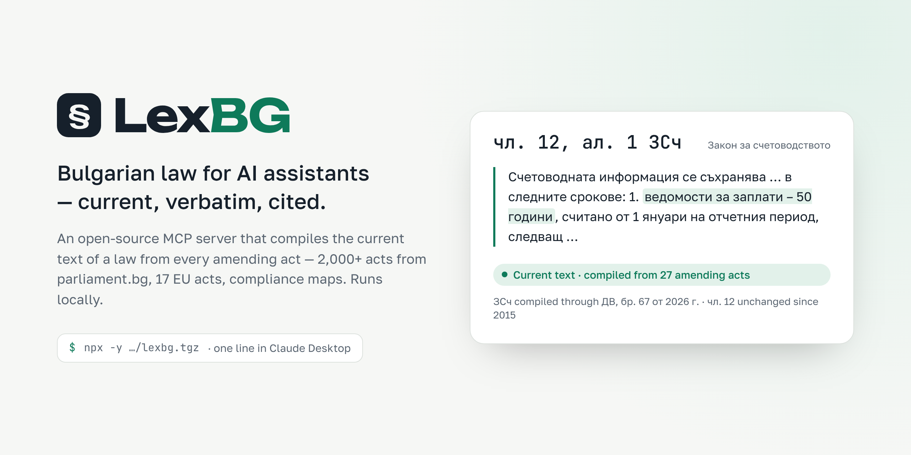
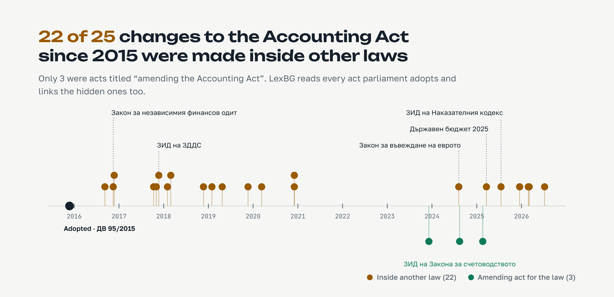
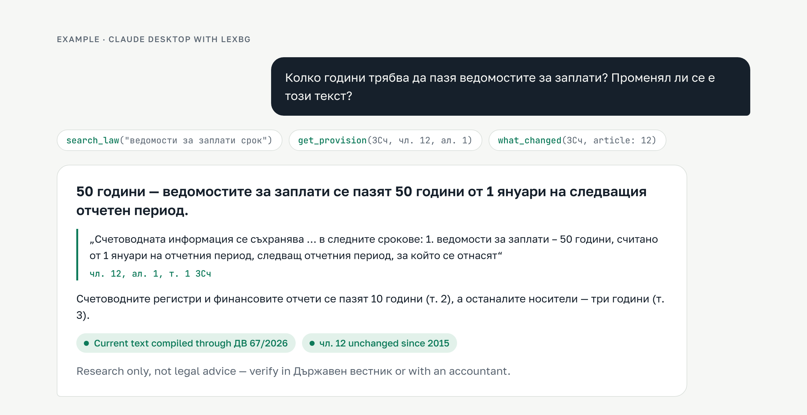
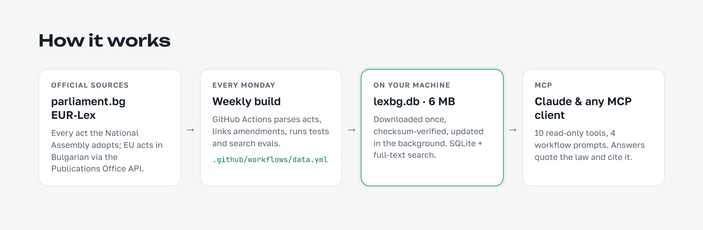

<p align="center">
  <picture>
    <source media="(prefers-color-scheme: dark)" srcset="docs/assets/hero-dark.png">
    
  </picture>
</p>

<p align="center">
  <a href="https://github.com/StanK1/lexbg-mcp/actions/workflows/ci.yml"></a>
  <a href="https://github.com/StanK1/lexbg-mcp/actions/workflows/data.yml"></a>
  <a href="https://github.com/StanK1/lexbg-mcp/releases/latest"></a>
  
  
</p>

<p align="center">
  <a href="https://stank1.github.io/lexbg-mcp/"><b>Website</b></a> ·
  <a href="#quick-start">Quick start</a> ·
  <a href="#what-you-can-ask">Use cases</a> ·
  <a href="docs/TOOLS.md">Tool reference</a> ·
  <a href="docs/HOW_IT_WORKS.md">How it works</a> ·
  <a href="#на-български">На български</a>
</p>

**LexBG** is an open-source [Model Context Protocol](https://modelcontextprotocol.io) server that gives Claude and other AI assistants reliable access to Bulgarian legislation. It builds the **current text** of a law itself, by applying every amending act from the State Gazette to the original, and it answers with the law word for word, cited the Bulgarian way (`чл. 12, ал. 1 ЗСч`), with the history of each provision and a plain warning wherever it could not keep up.

It runs on your machine. One line in Claude Desktop installs it; a 6 MB database, rebuilt every week from parliament.bg and EUR-Lex, downloads on first start.

> [!NOTE]
> LexBG is a research tool, not legal advice. Verify important answers in the State Gazette (Държавен вестник) or with a professional. See [DISCLAIMER.md](DISCLAIMER.md).

## Why LexBG

Ask a general-purpose AI about Bulgarian law and it answers from memory: plausible, often outdated, sometimes citing articles that don't exist. The underlying problem is that **a Bulgarian law in force is not one document.** It is the act as adopted plus every later amendment, and most amendments are not where you would look for them.

<picture>
  <source media="(prefers-color-scheme: dark)" srcset="docs/assets/amendments-dark.png">
  
</picture>

Across the 33 laws LexBG tracks, **935 of 1,157 amendments (81 %) were made inside other laws**: a paragraph in the VAT Act changes the Accounting Act, the budget law changes the tax code, the euro law changes sixteen laws at once. LexBG reads every act the National Assembly adopts and links those hidden changes to the law they modify.

Three principles follow from that:

| | |
|---|---|
| **Verbatim, never paraphrased** | Every provision comes from the official text, with its citation and source link. `validate_citation` catches references that don't exist. |
| **Honest about currency** | Each law is marked `compiled` (current text built by LexBG from the amendments), `consolidated` (imported current text), `original` (as first adopted) or `missing` (amendment history only). Any amendment LexBG could not apply is listed on the provision it concerns. |
| **Changes are first-class** | `what_changed` lists every amending act for a law or a single article, including amendments buried in other laws, with State Gazette references. |

## The current text, compiled from the amendments

Bulgaria has no official, free, machine-readable consolidated legislation: the State Gazette and parliament.bg publish each act as adopted. Free consolidated versions exist only on commercial sites. So LexBG does the consolidation itself:

1. **Read the instructions.** Amending acts follow a fixed drafting style: *„В чл. 38, ал. 9, т. 2 думите „31 март“ се заменят с „30 юни“.“* LexBG parses each instruction into a structured operation: replace, repeal, insert, renumber, wording changes, or sentence edits.
2. **Apply them in order of entry into force.** The order comes from each act's final provisions, not the order of publication. For example, the euro law was adopted in August 2024, but its changes to the Accounting Act took effect on 1 January 2026, after a later amending act. Changes that take effect in the future are listed but not applied.
3. **Mark every change the way official consolidations do**, for example `(изм. – ДВ, бр. 72 от 2024 г., в сила от 6.07.2024 г.)`, and keep a per-provision history.
4. **Never guess.** If an instruction is not understood or its target is not found, the provision keeps its last known text. `get_provision` then shows the instruction it could not apply and a warning. A law gets the `compiled` status only if at least 75 % of its instructions applied and no more than two amending acts are missing from the catalogue.

**Checked against an official text.** The Accounting Act was compiled as of August 2024 and compared with the consolidated version the Ministry of Finance published for that date. Articles 7, 25, 37 and 38 were checked; they are among the most amended in the law, changed by acts from 2016 to 2024. The wording matched, including the amendment notes, with one difference: a comma the official text has after „одит“ in чл. 38, ал. 9, т. 1 is not in the amending instruction itself. A second test went the other way. A 2019 snapshot of the law was imported as if it were an institution's PDF, then LexBG compiled forward from it. The result matched the text compiled from the 2015 original in every article.

| Law | Amending instructions applied | Provisions with an unapplied change |
|---|---:|---:|
| ЗСч — Accounting Act | 160 / 160 (100 %) | 0 |
| ЗМИП — Anti-Money Laundering Act | 523 / 554 (94 %) | 18 |
| ЗПУПС — Payment Services Act | 242 / 257 (94 %) | 9 |
| ЗНФО — Independent Financial Audit Act | 371 / 401 (93 %) | 14 |
| ЗПФИ — Markets in Financial Instruments Act | 754 / 858 (88 %) | 37 |
| All 9 compiled laws | 2,328 / 2,554 (91 %) | 99 of 1,405 |

## What you can ask

<picture>
  <source media="(prefers-color-scheme: dark)" srcset="docs/assets/example-dark.png">
  
</picture>

| Who | Typical question | What LexBG brings |
|---|---|---|
| **Founder or freelancer** | *„Имам ЕООД с двама служители и онлайн магазин. Какво трябва да спазвам?“* | `compliance_checklist` maps the business to the areas that apply (accounting, VAT, employment, consumer law, euro changeover…) with the first provisions to read |
| **Accountant** | *„Какво се промени в Закона за счетоводството от 2024 г. насам?“* | Every amending act since that date, including changes hidden in the euro law and the budget law, with the amending text |
| **Compliance team at a bank or fintech** | *„Кой е действителен собственик по ЗМИП и коя директива стои зад него?“* | The legal definition (`§ 2 от ДР на ЗМИП`), the EU directive it implements, and DORA / AMLR / MiCA texts in Bulgarian |
| **Developer building legal AI** | *„Провери цитатите в този договор.“* | A citation checker and verbatim retrieval you can put under any model, with a measured search quality |
| **Citizen** | *„Мога ли да се откажа от потребителски кредит?“* | The exact right and deadline (`чл. 29 ЗПК` — 14 days), quoted, plus whether the text has changed |

## Quick start

You need **Node.js 22.13 or newer** (`node --version`). Nothing to clone or build.

**Claude Desktop** · Settings → Developer → Edit Config:

```json
{
  "mcpServers": {
    "lexbg": {
      "command": "npx",
      "args": ["-y", "https://github.com/StanK1/lexbg-mcp/releases/latest/download/lexbg.tgz"]
    }
  }
}
```

Restart Claude Desktop and start a new chat. LexBG appears in the tools menu.

<details>
<summary><b>Claude Code, Docker and other clients</b></summary>

**Claude Code**

```bash
claude mcp add lexbg -- npx -y https://github.com/StanK1/lexbg-mcp/releases/latest/download/lexbg.tgz
```

**Docker**

```bash
docker run -i --rm -v lexbg-data:/data ghcr.io/stank1/lexbg
```

**Any MCP client** — run the `npx` command above as a stdio server.

| Setting | Default | Purpose |
|---|---|---|
| `LEXBG_DB` | – | Use this database file instead of downloading |
| `LEXBG_HOME` | `~/.lexbg` | Where the downloaded database lives |
| `LEXBG_OFFLINE=1` | off | Never use the network (needs a cached or local database) |

</details>

On first start LexBG downloads the weekly database (about 6 MB, checksum-verified) to `~/.lexbg/`. A new user is ready in about ten seconds; later starts take about one second and work offline. Once a day it checks for a newer weekly build in the background.

**Recommended:** add the Claude skill [`lexbg-research`](skills/lexbg-research/SKILL.md) (`lexbg-research-skill.zip` in the [latest release](https://github.com/StanK1/lexbg-mcp/releases/latest)). It teaches Claude the full method: search, quote, check amendments, validate citations.

## Tools and prompts

| Tool | What it answers |
|---|---|
| `search_law` | Full-text search in Bulgarian, ranked, with snippets, citations and a note when the relevant law has no text yet |
| `get_provision` | Verbatim article, § of the additional/transitional provisions, алинея or точка: its amendment history, any change LexBG could not apply, EU references |
| `what_changed` | Amendment history of a law, by date and by article, including amendments inside other laws, with entry-into-force dates |
| `validate_citation` | Does `чл. 6, ал. 1 ЗЗЛД` exist, has it been repealed, and what does it say? |
| `compliance_checklist` | Business profile in, applicable compliance areas out, with reasons and provisions to read |
| `get_topic` | One of 18 compliance topics: laws, typical questions, key provisions |
| `eu_links` | EU acts a law refers to, or Bulgarian provisions that refer to an EU act |
| `list_laws` · `about` | What is covered, how current it is, where it came from |
| `get_obligations` | Structured obligations (who / must / by when) with verified quotes — optional AI layer |

Four **prompts** package the method as one-click workflows: `legal_research`, `compliance_review`, `whats_new`, `check_citations`. Full parameters and example output: [docs/TOOLS.md](docs/TOOLS.md).

## How it works

<picture>
  <source media="(prefers-color-scheme: dark)" srcset="docs/assets/how-it-works-dark.png">
  
</picture>

- **Sources.** Every act the National Assembly has adopted since about 2005 (parliament.bg), and 17 EU acts in Bulgarian from the Publications Office (GDPR, DORA, the AI Act, NIS2, AMLR, MiCA, PSD2, the VAT Directive and others).
- **Weekly build.** A GitHub Action fetches new acts, parses them into articles and §, links amendments, compiles the current texts, runs 79 tests and the search evaluation, and publishes the database. If search quality drops, nothing is published.
- **On your machine.** One SQLite file with full-text search. LexBG does not run a model and sends nothing anywhere; your AI client decides when to call it.

More detail, including exactly what the AI sees: [docs/HOW_IT_WORKS.md](docs/HOW_IT_WORKS.md).

## Coverage today

| | |
|---|---|
| Promulgated acts in the catalogue | 2,064 (2005 → present), rebuilt weekly |
| Amendment links found | 1,157 (81 % inside other laws) |
| Bulgarian laws tracked | 33. Of these, 9 have a current text compiled by LexBG and 24 have the amendment history only |
| EU acts with full Bulgarian text | 17 |
| Compliance topics | 18 |

The parliament.bg catalogue starts around 2009. Laws adopted since then are compiled from their original act. Older laws (the Labour Code, the Commercial Act, the VAT and income tax acts, the social security code) need a starting text. `npm run fetch:agency` imports a consolidated text published by a public institution, reads which State Gazette issues it already includes, and LexBG applies every later amendment on top. See [DATA_SOURCES.md](DATA_SOURCES.md).

## Search quality

Search is measured on 32 real questions with answers verified by reading the law ([evals/retrieval.yml](evals/retrieval.yml)), and the weekly build fails if quality drops.

| | correct provision first | in top 3 | in top 5 | MRR |
|---|---:|---:|---:|---:|
| v0.2 keyword search | 56 % | 72 % | 78 % | 0.65 |
| **v0.3 relaxed matching + reranking** | **72 %** | **88 %** | **88 %** | **0.80** |

## Build the data yourself

```bash
git clone https://github.com/StanK1/lexbg-mcp.git && cd lexbg-mcp
npm install && npm run build
npm run fetch:parliament        # all acts (~45 min the first time; resumable)
npm run fetch:eurlex            # EU acts via the Publications Office API
npm run fetch:agency            # optional: consolidated texts from institutions (sources/agency-texts.yml)
npm run build:db && npm run coverage && npm test
```

A database built in the repository (`data/lexbg.db`) takes priority over the downloaded one. Step-by-step guide: [docs/LOCAL_SETUP.md](docs/LOCAL_SETUP.md).

<details>
<summary><b>Project layout</b></summary>

```
sources/      laws.yml · eu.yml · topics.yml — the registry (add laws and topics here)
src/          MCP server, query layer, parsers for Bulgarian and EU acts, citations, amendments
scripts/      fetchers, database builder, coverage, evaluation, obligation extraction
fixtures/     real public-domain acts used by the tests
evals/        search evaluation sets with verified answers
tests/        unit and end-to-end tests (a real MCP client against the server)
docs/         guides, tool reference, images
site/         the project website (GitHub Pages)
```

Built with the official TypeScript MCP SDK and Node's built-in SQLite. No native dependencies.

</details>

## Roadmap

- [x] Current texts compiled from the amending acts, applied in order of entry into force (v0.4)
- [ ] Starting texts from public institutions for the laws older than the catalogue (Labour Code, VAT, income taxes, social security, Commercial Act): the importer is ready, and official sources are being collected
- [ ] Raise the share of applied instructions for the financial-markets laws (currently 88–94 %)
- [ ] Hybrid search (embeddings next to full-text search), measured with the evaluation
- [ ] Court decisions and regulator guidance (data protection authority, tax authority)
- [ ] Benchmark: answers with and without LexBG on 100 Bulgarian compliance questions

## Contributing

Issues and pull requests are welcome — new laws for the registry, parser fixes, evaluation questions, consolidated texts from official sources. Start with [CONTRIBUTING.md](CONTRIBUTING.md).

## Acknowledgements and legal

- Normative acts and acts of state bodies are not subject to copyright in Bulgaria (чл. 4, т. 1 ЗАПСП). EU texts © European Union, [eur-lex.europa.eu](https://eur-lex.europa.eu), reused under the EUR-Lex legal notice. LexBG does not use commercial legal databases.
- The parliament.bg endpoints were first documented by Ansvar Systems' open-source [Bulgarian Law MCP](https://github.com/Ansvar-Systems/Bulgarian-law-mcp), which served as a reference. LexBG is an independent implementation.
- Code: [MIT License](LICENSE). Changes: [CHANGELOG.md](CHANGELOG.md).

---

## На български

**LexBG** е MCP сървър с отворен код, който дава на Claude и други AI асистенти надежден достъп до българското законодателство. Отговорите цитират закона дословно (`чл. 12, ал. 1 ЗСч`), показват какво се е променило след това и казват ясно, когато текстът може да не е актуален.

**Защо:** действащият закон не е един документ, а първоначалният текст плюс всички изменения — а 81 % от измененията на следените закони са направени в *други* закони (например чрез закона за еврото или закона за бюджета). LexBG чете всеки приет от Народното събрание акт и свързва тези скрити промени със закона, който променят.

**Актуален текст:** LexBG сам прилага измененията към първоначалния текст по реда на влизането им в сила и отбелязва всяка промяна така, както в официалните консолидирани текстове („изм. – ДВ, бр. 72 от 2024 г., в сила от 6.07.2024 г.“). Ако някое изменение не може да бъде приложено автоматично, това се показва при съответния член. Законът за счетоводството съвпада член по член с консолидирания текст на Министерството на финансите.

**Инсталация за една минута** — Claude Desktop → Settings → Developer → Edit Config:

```json
{ "mcpServers": { "lexbg": { "command": "npx", "args": ["-y", "https://github.com/StanK1/lexbg-mcp/releases/latest/download/lexbg.tgz"] } } }
```

При първо стартиране се изтегля готовата база данни (около 6 MB, обновява се всяка седмица от parliament.bg и EUR-Lex). След това LexBG стартира за секунда и работи офлайн.

**Примери:** *„Колко години се пазят ведомостите за заплати?“* · *„Какво се промени в ЗДДС от 2025 г.?“* · *„Имам ЕООД с онлайн магазин — какво трябва да спазвам?“* · *„Провери цитатите в този договор.“*

LexBG е инструмент за проучване, а не правен съвет. Проверявайте важните отговори в Държавен вестник или с адвокат или счетоводител.
