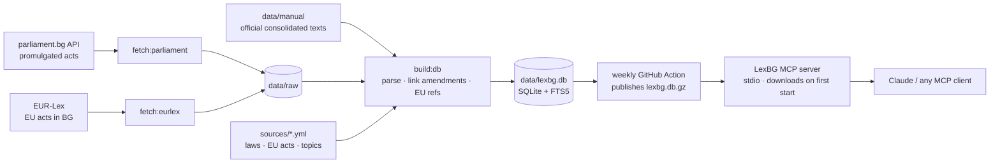

# LexBG

**An open-source MCP server that gives AI assistants reliable, citable access to Bulgarian legislation, its amendment history and the compliance requirements that follow from it.**

LexBG runs entirely on your machine: one SQLite file, no cloud services, no API key needed. Point Claude (or any MCP client) at it and ask in Bulgarian or English — answers come back as verbatim provisions with citations, plus an honest warning about whether the text is current.

[](https://github.com/StanK1/LexBG/actions/workflows/ci.yml)


> LexBG is a research tool, not legal advice. See [DISCLAIMER.md](DISCLAIMER.md).

---

## Why another legal MCP?

A Bulgarian law in force is rarely a single document. It is the original act **plus a chain of amendments** published in the State Gazette — and many of those amendments are hidden inside *other* laws ("§ 43. В Закона за счетоводството ... се правят следните изменения"). In the catalogue of acts the National Assembly publishes on parliament.bg, roughly **6 out of 10 acts are amending acts**.

Most tools index whatever text they can find and label it "in force". LexBG is built around the opposite principle: **never present stale text as current.**

| | What LexBG does |
|---|---|
| **Amendment tracking** | Links every promulgated act to the laws it changes — both direct amending acts *and* amendments buried in the transitional provisions of other laws. In the 6 test acts alone it finds 32 such links (the euro-adoption law quietly amends 16 tracked laws). |
| **Honest text status** | Every law is `consolidated` (current text imported from an official source), `original` (as first promulgated — later changes not applied) or `missing`. Every answer carries that warning. |
| **Structure-aware parsing** | Articles (чл.), and the § of the Additional / Transitional / Final provisions as separate units — so definitions like "§ 1. По смисъла на този закон…" are findable instead of being glued onto the last article. |
| **Citation checks** | `validate_citation` confirms that "чл. 12, ал. 1 ЗСч" exists and returns its exact text — a guard against hallucinated citations. |
| **EU ↔ BG links** | Detects references such as "Директива (ЕС) 2015/849" and maps them to CELEX numbers, both ways. |
| **Compliance layer** | 18 topic packs (company formation, accounting, VAT, employment, AML, GDPR, consumers, euro changeover, citizens' rights…) and a `compliance_checklist` that maps a business profile to the law areas and provisions to read first. |
| **Measured quality** | A retrieval eval with verified ground truth runs in CI (current baseline: hit@5 = 79 %, MRR = 0.70). |

## Tools

| Tool | What it answers |
|---|---|
| `about` | What is in the local database, how fresh it is, which topics exist |
| `list_laws` | Tracked laws and EU acts, text status, amendment counts |
| `search_law` | Full-text search (Bulgarian) with snippets and citations, filtered by law or topic |
| `get_provision` | Verbatim article / § / алинея / точка, EU references, later amendments that mention it |
| `validate_citation` | Does this citation exist? What does it say? |
| `what_changed` | Amendment history of a law, by date and by article |
| `eu_links` | Which EU acts a law refers to — or which Bulgarian provisions refer to an EU act |
| `get_topic` | A compliance topic: laws, typical questions, key provisions |
| `compliance_checklist` | Profile in (ЕООД, employees, sells online…) → applicable topics, reasons, provisions to read |
| `get_obligations` | Structured obligations (who / must / deadline) with verified verbatim quotes — optional AI layer |

**Prompts** (slash commands in clients that support them): `legal_research`, `compliance_review`, `whats_new`, `check_citations`.

## Quick start (1 minute)

**You need:** Node.js **22.13 or newer** (`node --version`). Nothing to clone or build.

**Claude Desktop** — Settings → Developer → Edit Config, add:

```json
{
  "mcpServers": {
    "lexbg": {
      "command": "npx",
      "args": ["-y", "https://github.com/StanK1/LexBG/releases/latest/download/lexbg.tgz"]
    }
  }
}
```

Restart Claude Desktop; the LexBG tools and prompts appear in the tools menu.

**Claude Code**

```bash
claude mcp add lexbg -- npx -y https://github.com/StanK1/LexBG/releases/latest/download/lexbg.tgz
```

**Docker** (any MCP client that can run a command)

```bash
docker run -i --rm -v lexbg-data:/data ghcr.io/stank1/lexbg
```

On first start LexBG downloads the ready-made database (rebuilt every week from parliament.bg and EUR-Lex, checksum-verified) to `~/.lexbg/`. After that it starts instantly, works offline, and checks once a day for the next weekly build. Tool calls made during the first download simply wait for it.

**Recommended:** install the Claude skill [`skills/lexbg-research`](skills/lexbg-research/SKILL.md) (`lexbg-research-skill.zip` in the [latest release](https://github.com/StanK1/LexBG/releases/latest)) so Claude follows the full research method. [docs/HOW_IT_WORKS.md](docs/HOW_IT_WORKS.md) explains what the model sees and how it decides which tool to call.

| Setting | Default | Purpose |
|---|---|---|
| `LEXBG_DB` | – | Use this database file instead of downloading |
| `LEXBG_HOME` | `~/.lexbg` | Where the downloaded database lives |
| `LEXBG_OFFLINE=1` | off | Never use the network (needs a cached or local database) |

### Build the data yourself (contributors)

```bash
git clone https://github.com/StanK1/LexBG.git && cd LexBG
npm install && npm run build
npm run fetch:parliament        # all acts (~45 min the first time; resumable)
npm run fetch:eurlex            # EU acts via the Publications Office API
npm run build:db && npm run coverage && npm run smoke
```

A database you build in the repository (`data/lexbg.db`) takes priority over the downloaded one. Step-by-step guide with troubleshooting: [docs/LOCAL_SETUP.md](docs/LOCAL_SETUP.md).

### Try it

- *"Колко години трябва да пазя ведомостите за заплати? Цитирай закона."*
- *"Какво се промени в Закона за счетоводството от 2024 г. насам?"*
- *"Имам ЕООД с двама служители и онлайн магазин. Какви закони трябва да спазвам?"*
- *"Кой е действителен собственик по ЗМИП и коя европейска директива стои зад закона?"*
- *"Провери дали съществува чл. 38, ал. 1 от Закона за счетоводството."*

## Getting current (consolidated) texts

parliament.bg publishes each act **as promulgated**. That gives LexBG the original text of laws adopted since about 2005 and the full amendment trail — but not the consolidated current wording, and nothing for older laws such as the Labour Code (1986) or the Commercial Act (1991).

To add the current text of a law, save it from an **official** state source as `data/manual/<law-id>.html` (or `.txt`) with a small `<law-id>.yml` describing where it came from, then run `npm run build:db`. LexBG marks it `consolidated` and still warns about any amendment promulgated after that date. Step-by-step instructions, and the sources you must **not** use, are in [DATA_SOURCES.md](DATA_SOURCES.md).

## Evaluation

```bash
npm run eval                                   # evals/retrieval.yml against your database
npm run eval -- --file evals/fixtures.yml --db <db>   # the CI eval on the test fixtures
```

Each case is a natural question plus the provision that answers it, verified by reading the law — not by looking at search results. The runner reports hit@1/3/5 and MRR and writes `data/eval-report.json`. Current baseline on the fixtures with keyword search only:

| hit@1 | hit@3 | hit@5 | MRR |
|---:|---:|---:|---:|
| 64 % | 71 % | 79 % | 0.70 |

The misses are instructive: short definitional articles ("Чл. 3. Мерките … са: …") lose to longer articles that repeat the query words. That is exactly what hybrid (semantic + keyword) search should fix — see the roadmap.

## Optional: obligation extraction (AI layer)

```bash
ANTHROPIC_API_KEY=... npm run extract:obligations -- --law zsch --limit 5
```

An LLM reads each provision and proposes obligations (*who* must do *what*, *by when*). LexBG keeps an item **only if its quote appears verbatim in the provision**, writes them to `data/obligations/<law>.json` as `unreviewed`, and serves them through `get_obligations` after `npm run build:db`. Mark items `approved` or `rejected` after a human review. The model is configurable with `LEXBG_MODEL`.

## How it works



```
sources/          laws.yml · eu.yml · topics.yml — the registry (edit these to add laws or topics)
src/              MCP server, query layer, parsers (Bulgarian acts, EU acts, citations, EU refs)
scripts/          fetchers, database builder, coverage, eval, obligation extraction
fixtures/         real public-domain acts from parliament.bg used by the tests
evals/            retrieval eval sets
tests/            unit + end-to-end tests (real MCP client against an in-memory server)
```

Built with the official TypeScript MCP SDK and Node's built-in `node:sqlite` (FTS5) — no native dependencies to compile.

## Roadmap

- [ ] Hybrid search: multilingual embeddings next to FTS5, measured with the eval
- [ ] Court decisions from the central court-acts portal (anonymised acts, published under the Judiciary Act)
- [ ] Regulator guidance: data-protection authority (КЗЛД) decisions and opinions, tax authority guidance
- [ ] Remote deployment (Streamable HTTP) and support for the 2026-07-28 MCP specification once the SDK ships it
- [ ] Hallucination benchmark: answers *with* vs *without* LexBG on 100 Bulgarian compliance questions
- [ ] More consolidated texts contributed from official sources

## Acknowledgements

The parliament.bg endpoints used here were first documented by Ansvar Systems' open-source [Bulgarian Law MCP](https://github.com/Ansvar-Systems/Bulgarian-law-mcp) (Apache-2.0), which served as a reference. LexBG is an independent implementation with a different design: amendment tracking, explicit text status, structure-aware parsing and a compliance layer.

## Legal

- Normative acts, acts of state bodies and court acts are **not subject to copyright** in Bulgaria (чл. 4, т. 1 от Закона за авторското право и сродните му права). EUR-Lex content may be reused free of charge.
- LexBG does not scrape commercial legal databases. Their consolidated texts are their product.
- Not legal advice — see [DISCLAIMER.md](DISCLAIMER.md).

Code licensed under the [MIT License](LICENSE).

---

## На български

**LexBG** е MCP сървър с отворен код, който дава на AI асистенти достъп до българското законодателство с точни цитати, история на измененията и карта на задълженията по теми (регистрация на фирма, счетоводство, ДДС, трудово право, ЗМИП, лични данни, потребители, еврото и др.).

Инсталация за една минута — добавете в Claude Desktop (Settings → Developer → Edit Config):

```json
{ "mcpServers": { "lexbg": { "command": "npx", "args": ["-y", "https://github.com/StanK1/LexBG/releases/latest/download/lexbg.tgz"] } } }
```

При първо стартиране LexBG изтегля готовата база данни (обновява се всяка седмица от parliament.bg и EUR-Lex) и след това стартира веднага и работи офлайн. Всеки отговор съдържа предупреждение дали текстът е актуален (консолидиран), оригинален (без последващите изменения) или липсва. LexBG е инструмент за проучване, а не правен съвет.
