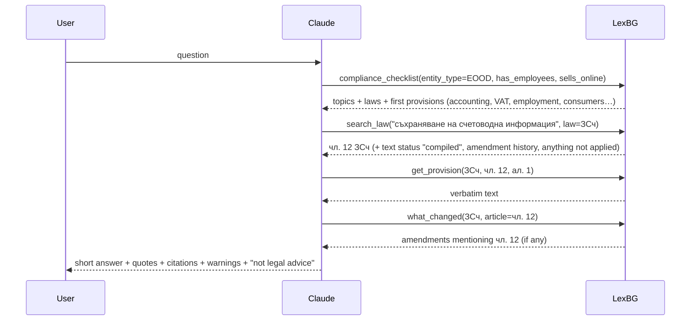

# How an AI uses LexBG

LexBG does **not** run an AI model and has **no hidden prompt**. It is a tool server: it describes what it can do, and the AI assistant (Claude, Cursor, …) decides when to call it. Three things shape that decision.

## 1. What the model sees when LexBG connects

When the client starts LexBG it receives, over the MCP protocol:

| What | Where it comes from | Role |
|---|---|---|
| **Server instructions** | `SERVER_INSTRUCTIONS` in [`src/workflow.ts`](../src/workflow.ts) | A short paragraph the client may add to the model's context: the research method and the rules (quote, check amendments, never invent articles, pass on warnings). |
| **10 tools** — name, description, input schema | `registerTool(...)` in [`src/server.ts`](../src/server.ts) | The model reads the descriptions to decide which tool fits the user's question, and the schema to fill in the arguments. |
| **4 prompts** — `legal_research`, `compliance_review`, `whats_new`, `check_citations` | `registerPrompt(...)` in [`src/server.ts`](../src/server.ts), text in [`src/workflow.ts`](../src/workflow.ts) | Ready-made workflows the *user* can pick (slash commands / prompt templates in clients that support them). |

Nothing else is injected. The tool *results* are plain JSON with verbatim law text, citations, `text_status` and a `warning`.

## 2. The skill (optional, recommended)

[`skills/lexbg-research/SKILL.md`](../skills/lexbg-research/SKILL.md) is a Claude Skill: a longer playbook that Claude loads when a question is about Bulgarian law. It is **not** added automatically by the MCP server — skills and MCP servers are separate features. Install it once:

- **Claude Code:** copy the folder to `~/.claude/skills/lexbg-research/` (or into a project's `.claude/skills/`).
- **Claude apps:** upload `lexbg-research-skill.zip` from the latest release in Claude's Skills settings.

Without the skill, Claude still uses LexBG well thanks to the server instructions and tool descriptions; with it, answers follow the method more consistently (always check `what_changed`, always validate citations, fixed answer format).

## 3. The logic of a typical question

> *"Имам ЕООД с двама служители и онлайн магазин. Колко време трябва да пазя счетоводните документи и какво още трябва да спазвам?"*



1. **Broad question** → `compliance_checklist` maps the profile to topic packs and returns the provisions to read first.
2. **Specific question** → `search_law` finds candidate provisions (keyword search over the stored texts).
3. **Grounding** → `get_provision` returns the exact text the answer quotes.
4. **Currency** → `what_changed` and `possible_later_changes` show amendments that the stored text may not include.
5. **Safety net** → `validate_citation` catches citations that do not exist.

The model may skip steps on simple questions; the server instructions, the skill and the prompts all push it to follow the full method on anything that matters.

## 4. Where the data comes from at runtime

```
first start ──► ~/.lexbg/lexbg.db missing? ──► download lexbg.db.gz from the "data" release (checksummed)
every start ──► open the local SQLite file (milliseconds) ──► once a day, check for a newer weekly build
```

The weekly build runs on GitHub Actions ([`data.yml`](../.github/workflows/data.yml)): it fetches new acts from parliament.bg and EU acts from the Publications Office, rebuilds the database, runs the tests, and publishes it. Users never run the slow download themselves.
